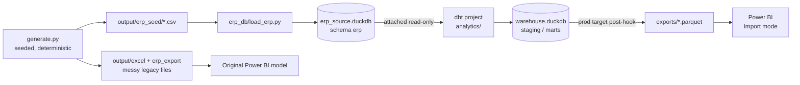

# Construction management P&L: from spreadsheets to a dbt warehouse

[Português](README.pt-BR.md)

> **All data here is fictitious.** Company names, people, CNPJs (formatted, with deliberately invalid check digits), values and dates are generated. Nothing comes from the original client.

A portfolio project that rebuilds a construction company's management P&L (DRE gerencial de obras) twice:

1. **As it was**: a Power BI model that read hand-maintained Excel files from fixed local paths, with the cleanup logic buried in M and DAX.
2. **As it should be**: an ERP source → dbt → star schema pipeline on DuckDB, tested, incremental, and exported to Power BI as Parquet.

Both versions run on the same synthetic data, so their totals can be compared line by line.

## Architecture



| Folder | What it holds |
|---|---|
| [generate.py](generate.py) | Synthetic data generator: one fictitious ERP in memory, written out as clean CSVs and as the legacy Excel/CSV files |
| [erp_db/](erp_db/) | DDL of the source ERP ([schema.sql](erp_db/schema.sql)) and the loader that builds `output/erp_source.duckdb` |
| [analytics/](analytics/) | dbt project (DuckDB adapter): staging, intermediate, marts, seeds, snapshot, analyses, singular tests |
| [tests/](tests/) | Python tests for the generator |
| `output/` | Generated files (not versioned) |

## Quick start

Requirements: Python 3.14+ and [uv](https://docs.astral.sh/uv/) (or `pip install -r requirements.txt` for the generator only).

```bash
uv sync                                  # generator + dbt + duckdb
uv run python generate.py                # --seed 42 --out output
uv run python erp_db/load_erp.py         # builds output/erp_source.duckdb (no server, no password)
uv run python -m unittest discover -s tests -v

cd analytics
dbt deps
dbt build                                # seeds, snapshot, models and tests (dev target)
dbt build --target prod                  # also writes the marts to exports/ for Power BI
```

dbt needs a `construction_pnl` profile in `~/.dbt/profiles.yml`:

```yaml
construction_pnl:
  target: dev
  outputs:
    dev:
      type: duckdb
      path: "{{ env_var('DBT_DUCKDB_PATH', 'warehouse.duckdb') }}"
      schema: dev
      threads: 4
      attach:
        - path: "{{ env_var('ERP_DUCKDB_PATH', '../output/erp_source.duckdb') }}"
          alias: erp_source
          options: {read_only: true}
    prod:   # same as dev, with schema: analytics
```

Re-running the generator with the same seed produces byte-identical seed files (this is tested).

## Data generator

`generate.py` builds one ERP and writes it out twice:

| Output | Purpose |
|---|---|
| `output/erp_seed/*.csv` → `output/erp_source.duckdb` (schema `erp`) | A clean, normalized **source system** for the dbt pipeline |
| `output/excel/*.xlsx`, `*.xls` and `output/erp_export/*.csv` | The **messy files the original Power BI model reads**: same file names, sheet names, header rows, column names and known data issues, so the original PBIP refreshes once its paths are updated |

Both outputs come from the same records, so the Excel totals reconcile with the ERP database.

| Dataset (seed 42) | Rows |
|---|---|
| Works + administrative cost centers | 36 + 4 |
| Partner shares | 101 |
| Companies (partners, suppliers, clients) | 44 |
| Financial entries (ERP) | 22,739 |
| Excel `BD EFETUADO` / `BD COMPROMISSADO` | 16,026 / 5,666 |
| ERP CSV extract (Oct 2025 – Jan 2026) | 2,230 |

Business rules the data follows: works have 4-digit numbers; `valor_compromissado` (TOTCOMP) holds only the amount still to receive or pay, so Total = Comp. + Efetuado, as in ERP report 3.29; deferred revenue and termination accruals stay committed; operations 510 (revenue received), 733 (tax transfer) and 823 (revenue transfer) exist; cost classes are MATERIAL, MÃO DE OBRA, EQUIPAMENTO, SERVIÇO TERCEIRIZADO, TAXAS E IMPOSTOS and GASTOS GERAIS.

## dbt project

| Layer | Materialization | Models |
|---|---|---|
| Sources | DuckDB file attached read-only | `erp.empresa`, `plano_contas`, `operacao`, `obra`, `obra_socio`, `lancamento` (freshness on `updated_at`) |
| Staging | view | `stg_*`: renaming, types, one model per source table |
| Intermediate | ephemeral | `int_lancamento_classificado`: P&L scope, operation category, partner contribution/refund, INSS offset |
| Seeds | table | `categoria_operacao`, `plano_contas_grupo`, `acesso_usuario` |
| Snapshot | SCD Type 2 | `snap_obra_socio`: history of partner shares per work |
| Marts | table / incremental | star schema below |

**Marts (star schema)**

| Model | Type | Grain / notes |
|---|---|---|
| `fct_lancamento` | Fact, incremental merge | One financial document installment. Merge on `updated_at` with a lookback window (`incremental_lookback_days`); idempotent; enforced contract |
| `fct_posicao_economica_mensal` | Periodic snapshot, incremental | Closing month × work × P&L account. Closed months are frozen; an incremental run re-saves only the closing month (`mes_fechamento`) |
| `dim_obra` | SCD Type 1 | Works (cost centers); `-1` = unknown member |
| `dim_conta` | Dimension | Chart of accounts with a 3-level hierarchy and nature (RECEITA / DESPESA / FORA_DRE) |
| `dim_empresa` | Role-playing | Counterpart, receiving/paying company and partner |
| `dim_operacao` | Dimension | ERP operation codes with business category |
| `dim_date` | Dimension | Calendar 2022–2030 with pt-BR labels |
| `bridge_obra_socio` | Bridge, SCD Type 2 | Partner shares per work with `valido_de` / `valido_ate` / `is_current` |
| `seg_acesso_usuario` | Security | Row-level security map for Power BI (e-mail → business unit) |

All marts are declared as an [exposure](analytics/models/marts/marts.yml) for the Power BI report.

**Design decisions**

- **Hard-coded lists become data.** The M/DAX lists of account codes and operation codes became seeds and derived columns (`natureza` from the account prefix, `categoria_operacao` from a seed), so a new code is a CSV edit, not a report change.
- **Unknown members instead of dropped rows.** Every fact foreign key falls back to `-1`, so totals never silently lose rows the way the original filters did.
- **Power BI reads files, not the database.** On the `prod` target, a post-hook ([export_parquet](analytics/macros/export_parquet.sql)) writes each mart to `exports/<model>.parquet` (or CSV via `export_format`), so a dbt run never fights Power BI for the DuckDB lock.
- **Monthly versions are kept.** The requirement "the economic position must be saved monthly" is met by a periodic snapshot fact rather than by copying files.

**Variables** (`dbt_project.yml`): `incremental_lookback_days` (3), `reprocess_from_month`, `mes_fechamento` (default: previous month), `export_path`, `export_format`.

**Analyses** (`dbt compile`, run the SQL by hand):

- [demonstrativo_economico_329.sql](analytics/analyses/demonstrativo_economico_329.sql): reproduces the ERP report "3.29 – Demonstrativo Sintético Econômico" for one work and period.
- [dre_por_obra.sql](analytics/analyses/dre_por_obra.sql): P&L by work and month, to check Power BI totals against SQL.

## Tests

| Kind | Where | What it checks |
|---|---|---|
| Python | [tests/test_generate.py](tests/test_generate.py) | Determinism, file layouts, Excel totals reconcile with the ERP |
| Generic dbt | [marts.yml](analytics/models/marts/marts.yml), [seeds.yml](analytics/seeds/seeds.yml) | Keys unique/not null, relationships, accepted values, non-negative amounts, composite keys |
| Contract | `fct_lancamento` | Column names, types and constraints enforced at build time |
| Singular SQL | [analytics/tests/](analytics/tests/) | Fact reconciles with the ERP source (count and amounts); current partner shares add up to 100%; latest monthly position matches the fact at the cut-off |

## Source → Power BI mapping (legacy files)

| File / sheet | Read by (M query) | Layout reproduced |
|---|---|---|
| `Banco de Dados Gerencial - Set_2025.xlsx` / `BD EFETUADO` | `BD EFETUADO`, `BD EFETUADO (2)` → `fct_gerencial`, `dim_socio` | Blank column A; 13 rows above the header; 73 columns, with blank Column20 and Column57–73; extra calculation columns removed by M |
| same / `BD COMPROMISSADO` | `BD COMPROMISSADO`, `BD COMPROMISSADO (2)` | Blank column A; 8 rows above the header; `FORNECEDOR` / `DESCRIÇÃO DA EMPRESA` renamed by M; total row at the bottom |
| `Classificação das Obras.xlsx` / `Classif. Obras` | `CLASSIFICAÇÃO DAS OBRAS` | 2 title rows, a header row, 1 sub-header row; 91 columns (24 partner slots × description / % share / % TAC) |
| `Classificação das Obras 2.0.xlsx` / `Aurora` | `Gerencia` | Header in row 1; partner slot 1 only |
| `Lista Plano de Contas .xls` / `Planilha1` | `Lista de Plano de Contas` | Legacy `.xls`; integer account codes; 3 stray blank columns |
| `erp_export/_SELECT_RZ_…_dados.csv` | `_SELECT_RZ_…` | 79 `RZANALCONSOL_*` columns, comma-delimited, unquoted |

## Data-issue catalog

"Observed" means the issue is evidenced by a step in the original M/DAX code. "Synthetic" means it was added as a test case. The dbt pipeline avoids all of them by reading the normalized ERP instead of the spreadsheets.

| # | Issue | Where | Origin |
|---|---|---|---|
| 1 | Title rows above the header; blank first column | BD sheets, Classif. | Observed (`Table.Skip`, `RemoveColumns Column1`) |
| 2 | Unnamed columns (Column20, Column57–73, Column91) | BD EFETUADO, Classif. | Observed |
| 3 | Line breaks inside headers (`DT.\nMOVBANC`, `% …\n…`) | BD sheets, Classif. | Observed (`#(lf)` in M) |
| 4 | Account codes as dotted text (`2.003.01.0001`) vs integers in the lookup | BD vs Lista | Observed (`ReplaceValue "."`) |
| 5 | Total row and blank rows without a cost center | BD COMPROMISSADO | Observed (filter `CENTRO DE CUSTO <> null`) |
| 6 | Realized entries without a bank date (null or `""`) are silently dropped | BD EFETUADO | Observed filter; affected rows synthetic (~0.4%) |
| 7 | Cost center replaced by `INATIVO` for closed works | BD sheets | Observed (filter in `dim_socio`) |
| 8 | Accounts outside the 1/2 prefixes (3xxx, 4xxx) kept only in `dim_socio` | BD sheets | Observed |
| 9 | Revenue/expense decided by a hard-coded list of 21 account codes | M step | Observed |
| 10 | Misspelled manager name, fixed by a hard-coded replace | Classif. | Observed |
| 11 | Header typos: `Particiapação`, trailing space `TIPO `, double space `Sócio 1  - % TAC` | Classif., 2.0 | Observed |
| 12 | Blank partner descriptions filled with `FillDown`/`FillUp`, which can bleed names across works | Classif. | Observed step; blanks synthetic (~5%) |
| 13 | Hard-coded exclusion of numbers 1 and 100–179 (except 139, 155, 175); here 1/101/120/150 are administrative cost centers (hypothesis) | Classif. | Observed |
| 14 | Two classification files out of sync (missing works, drifting contract values) | Classif. vs 2.0 | Inferred from the two sources; values synthetic |
| 15 | Legacy `.xls`; trailing space in the file name; some accounts have no rule and drop out of the lookup | Lista | Observed |
| 16 | CSV with no quoting: commas inside `HISTORICO` shift columns | ERP CSV | Inferred from `QuoteStyle.None`; ~1% of expense rows |
| 17 | Exact duplicate rows (copy/paste) | BD EFETUADO | Synthetic (~0.5%) |
| 18 | Snapshot date taken from the file's "Date created" metadata | M step | Observed (machine-dependent; not reproducible) |

## Limits

- Distributions such as monthly billing, expense mix, tax rates and partner shares are plausible but invented. They don't reflect the original business.
- The RLS e-mails in `acesso_usuario` are placeholders; the real access list was never part of the original project.
- `is_centro_administrativo` (works 1/101/120/150) is a hypothesis for the original hard-coded filter, not a confirmed rule.
- The original model still needs updated file paths and a few renamed literals before it refreshes against the legacy files. That edit list is kept privately, not in this repo.
