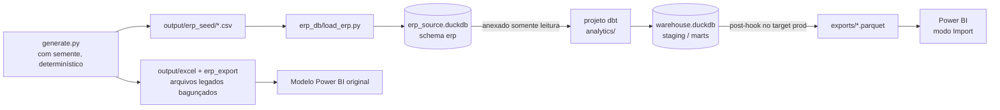

# DRE gerencial de obras: das planilhas a um data warehouse com dbt

[English](README.md)

> **Todos os dados são fictícios.** Empresas, pessoas, CNPJs (formatados, com dígitos verificadores propositalmente inválidos), valores e datas são gerados. Nada vem do cliente original.

Projeto de portfólio que reconstrói a DRE gerencial de obras de uma construtora de duas formas:

1. **Como era**: um modelo Power BI que lia planilhas Excel mantidas à mão em caminhos locais fixos, com a limpeza escondida em M e DAX.
2. **Como deveria ser**: um pipeline ERP → dbt → esquema estrela em DuckDB, testado, incremental e exportado para o Power BI em Parquet.

As duas versões rodam sobre os mesmos dados sintéticos, então os totais podem ser comparados linha a linha.

## Arquitetura


### Detalhes de Arquitetura


| Pasta | Conteúdo |
|---|---|
| [generate.py](generate.py) | Gerador de dados sintéticos: um ERP fictício em memória, gravado como CSVs limpos e como os arquivos Excel/CSV legados |
| [erp_db/](erp_db/) | DDL do ERP de origem ([schema.sql](erp_db/schema.sql)) e o carregador que cria `output/erp_source.duckdb` |
| [analytics/](analytics/) | Projeto dbt (adaptador DuckDB): staging, intermediate, marts, seeds, snapshot, analyses, testes singulares |
| [dashboard/](dashboard/) | `BI_Gerencial_Construtora_Data.pbip`: relatório Power BI sobre os Parquet do dbt (parâmetro `ExportPath`, RLS `Unidade de Negocio`) |
| [tests/](tests/) | Testes Python do gerador |
| `output/` | Arquivos gerados (não versionados) |

## Como executar

Requisitos: Python 3.14+ e [uv](https://docs.astral.sh/uv/) (ou `pip install -r requirements.txt` só para o gerador).

```bash
uv sync                                  # gerador + dbt + duckdb
uv run python generate.py                # --seed 42 --out output
uv run python erp_db/load_erp.py         # cria output/erp_source.duckdb (sem servidor, sem senha)
uv run python -m unittest discover -s tests -v

cd analytics
dbt deps
dbt build                                # seeds, snapshot, modelos e testes (target dev)
dbt build --target prod                  # também grava os marts em exports/ para o Power BI
```

O dbt precisa de um perfil `construction_pnl` em `~/.dbt/profiles.yml`:

```yaml
construction_pnl:
  target: dev
  outputs:
    dev:
      type: duckdb
      path: "{{ env_var('DBT_DUCKDB_PATH', 'warehouse.duckdb') }}"
      schema: dev
      threads: 4
      attach:
        - path: "{{ env_var('ERP_DUCKDB_PATH', '../output/erp_source.duckdb') }}"
          alias: erp_source
          options: {read_only: true}
    prod:   # igual ao dev, com schema: analytics
```

Rodar o gerador de novo com a mesma semente produz arquivos seed idênticos byte a byte (há teste para isso).

## Gerador de dados

O `generate.py` monta um único ERP e o grava de duas formas:

| Saída | Para quê |
|---|---|
| `output/erp_seed/*.csv` → `output/erp_source.duckdb` (schema `erp`) | **Sistema de origem** limpo e normalizado para o pipeline dbt |
| `output/excel/*.xlsx`, `*.xls` e `output/erp_export/*.csv` | **Os arquivos bagunçados que o modelo Power BI original lê**: mesmos nomes de arquivo e de aba, linhas de cabeçalho, nomes de coluna e problemas conhecidos, então o PBIP original atualiza depois de ajustar os caminhos |

As duas saídas vêm dos mesmos registros, então os totais do Excel batem com o banco do ERP.

| Conjunto (semente 42) | Linhas |
|---|---|
| Obras + centros de custo administrativos | 36 + 4 |
| Participações de sócios | 101 |
| Empresas (sócias, fornecedores, clientes) | 44 |
| Lançamentos financeiros (ERP) | 22.739 |
| Excel `BD EFETUADO` / `BD COMPROMISSADO` | 16.026 / 5.666 |
| Extração CSV do ERP (out/2025 – jan/2026) | 2.230 |

Regras de negócio que os dados seguem: obras têm número de 4 dígitos; `valor_compromissado` (TOTCOMP) guarda só o que falta receber ou pagar, então Total = Comp. + Efetuado, como no relatório 3.29 do ERP; receita diferida e provisões de rescisão ficam como compromissadas; existem as operações 510 (receita recebida), 733 (repasse de imposto) e 823 (repasse de receita); as classes de custo são MATERIAL, MÃO DE OBRA, EQUIPAMENTO, SERVIÇO TERCEIRIZADO, TAXAS E IMPOSTOS e GASTOS GERAIS.

## Projeto dbt

| Camada | Materialização | Modelos |
|---|---|---|
| Sources | Arquivo DuckDB anexado somente leitura | `erp.empresa`, `plano_contas`, `operacao`, `obra`, `obra_socio`, `lancamento` (freshness em `updated_at`) |
| Staging | view | `stg_*`: renomeação, tipos, um modelo por tabela de origem |
| Intermediate | ephemeral | `int_lancamento_classificado`: escopo da DRE, categoria da operação, aporte/devolução de sócio, compensação de INSS |
| Seeds | tabela | `categoria_operacao`, `plano_contas_grupo`, `acesso_usuario` |
| Snapshot | SCD Tipo 2 | `snap_obra_socio`: histórico das participações dos sócios por obra |
| Marts | tabela / incremental | esquema estrela abaixo |

**Marts (esquema estrela)**

| Modelo | Tipo | Granularidade / observações |
|---|---|---|
| `fct_lancamento` | Fato, merge incremental | Uma parcela de documento financeiro. Merge por `updated_at` com janela de reprocessamento (`incremental_lookback_days`); idempotente; contrato imposto |
| `fct_posicao_economica_mensal` | Snapshot periódico, incremental | Mês de fechamento × obra × conta da DRE. Meses fechados ficam congelados; a execução incremental regrava só o mês de fechamento (`mes_fechamento`) |
| `dim_obra` | SCD Tipo 1 | Obras (centros de custo); `-1` = membro desconhecido |
| `dim_conta` | Dimensão | Plano de contas com hierarquia de 3 níveis e natureza (RECEITA / DESPESA / FORA_DRE) |
| `dim_empresa` | Role-playing | Contraparte, empresa de recebimento/pagamento e sócio |
| `dim_operacao` | Dimensão | Códigos de operação do ERP com categoria de negócio |
| `dim_date` | Dimensão | Calendário 2022–2030 com rótulos em pt-BR |
| `bridge_obra_socio` | Ponte, SCD Tipo 2 | Participação dos sócios por obra com `valido_de` / `valido_ate` / `is_current` |
| `seg_acesso_usuario` | Segurança | Mapa de segurança em nível de linha (RLS) para o Power BI (e-mail → unidade de negócio) |

Todos os marts estão declarados como [exposure](analytics/models/marts/marts.yml) do relatório Power BI.

**Decisões de modelagem**

- **Listas fixas viram dados.** As listas de códigos de conta e de operação no M/DAX viraram seeds e colunas derivadas (`natureza` pelo prefixo da conta, `categoria_operacao` por seed). Um código novo é uma edição de CSV, não do relatório.
- **Membro desconhecido em vez de linha descartada.** Toda chave estrangeira do fato cai em `-1` quando não acha correspondência, então os totais nunca perdem linhas em silêncio como nos filtros originais.
- **O Power BI lê arquivos, não o banco.** No target `prod`, um post-hook ([export_parquet](analytics/macros/export_parquet.sql)) grava cada mart em `exports/<modelo>.parquet` (ou CSV via `export_format`), para o dbt nunca disputar o lock do DuckDB com o Power BI.
- **As versões mensais são guardadas.** A regra "a versão dos dados da posição econômica deve ser salva mensalmente" é atendida por um fato de snapshot periódico, não por cópias de arquivo.

**Variáveis** (`dbt_project.yml`): `incremental_lookback_days` (3), `reprocess_from_month`, `mes_fechamento` (padrão: mês anterior), `export_path`, `export_format`.

**Analyses** (`dbt compile` e rodar o SQL manualmente):

- [demonstrativo_economico_329.sql](analytics/analyses/demonstrativo_economico_329.sql): reproduz o relatório do ERP "3.29 – Demonstrativo Sintético Econômico do Período" para uma obra e um período.
- [dre_por_obra.sql](analytics/analyses/dre_por_obra.sql): DRE por obra e mês, para conferir os totais do Power BI com o SQL.

## Testes

| Tipo | Onde | O que verifica |
|---|---|---|
| Python | [tests/test_generate.py](tests/test_generate.py) | Determinismo, layout dos arquivos, totais do Excel batendo com o ERP |
| dbt genéricos | [marts.yml](analytics/models/marts/marts.yml), [seeds.yml](analytics/seeds/seeds.yml) | Chaves únicas/não nulas, relacionamentos, valores aceitos, valores não negativos, chaves compostas |
| Contrato | `fct_lancamento` | Nomes, tipos e restrições das colunas verificados no build |
| SQL singulares | [analytics/tests/](analytics/tests/) | Fato concilia com o ERP (contagem e valores); participações atuais dos sócios somam 100%; última posição mensal bate com o fato na data de corte |

## Mapeamento origem → Power BI (arquivos legados)

| Arquivo / aba | Lido por (consulta M) | Layout reproduzido |
|---|---|---|
| `Banco de Dados Gerencial - Set_2025.xlsx` / `BD EFETUADO` | `BD EFETUADO`, `BD EFETUADO (2)` → `fct_gerencial`, `dim_socio` | Coluna A vazia; 13 linhas acima do cabeçalho; 73 colunas, com Column20 e Column57–73 vazias; colunas de cálculo extras removidas no M |
| mesmo / `BD COMPROMISSADO` | `BD COMPROMISSADO`, `BD COMPROMISSADO (2)` | Coluna A vazia; 8 linhas acima do cabeçalho; `FORNECEDOR` / `DESCRIÇÃO DA EMPRESA` renomeadas no M; linha de total no fim |
| `Classificação das Obras.xlsx` / `Classif. Obras` | `CLASSIFICAÇÃO DAS OBRAS` | 2 linhas de título, cabeçalho, 1 linha de subcabeçalho; 91 colunas (24 posições de sócio × descrição / % participação / % TAC) |
| `Classificação das Obras 2.0.xlsx` / `Aurora` | `Gerencia` | Cabeçalho na linha 1; só a posição de sócio 1 |
| `Lista Plano de Contas .xls` / `Planilha1` | `Lista de Plano de Contas` | `.xls` legado; códigos de conta inteiros; 3 colunas vazias soltas |
| `erp_export/_SELECT_RZ_…_dados.csv` | `_SELECT_RZ_…` | 79 colunas `RZANALCONSOL_*`, separadas por vírgula, sem aspas |

## Catálogo de problemas de dados

"Observado" significa que há um passo no código M/DAX original que comprova o problema. "Sintético" significa que foi adicionado como caso de teste. O pipeline dbt evita todos eles por ler o ERP normalizado em vez das planilhas.

| # | Problema | Onde | Origem |
|---|---|---|---|
| 1 | Linhas de título acima do cabeçalho; primeira coluna vazia | Abas BD, Classif. | Observado (`Table.Skip`, `RemoveColumns Column1`) |
| 2 | Colunas sem nome (Column20, Column57–73, Column91) | BD EFETUADO, Classif. | Observado |
| 3 | Quebras de linha dentro dos cabeçalhos (`DT.\nMOVBANC`, `% …\n…`) | Abas BD, Classif. | Observado (`#(lf)` no M) |
| 4 | Código de conta como texto com pontos (`2.003.01.0001`) vs inteiro na tabela de apoio | BD vs Lista | Observado (`ReplaceValue "."`) |
| 5 | Linha de total e linhas vazias sem centro de custo | BD COMPROMISSADO | Observado (filtro `CENTRO DE CUSTO <> null`) |
| 6 | Lançamentos realizados sem data bancária (null ou `""`) descartados em silêncio | BD EFETUADO | Filtro observado; linhas afetadas sintéticas (~0,4%) |
| 7 | Centro de custo trocado por `INATIVO` em obras encerradas | Abas BD | Observado (filtro em `dim_socio`) |
| 8 | Contas fora dos prefixos 1/2 (3xxx, 4xxx) mantidas só em `dim_socio` | Abas BD | Observado |
| 9 | Receita/despesa definida por uma lista fixa de 21 códigos de conta | Passo M | Observado |
| 10 | Nome de gerente com erro de digitação, corrigido por substituição fixa | Classif. | Observado |
| 11 | Erros nos cabeçalhos: `Particiapação`, espaço no fim de `TIPO `, espaço duplo em `Sócio 1  - % TAC` | Classif., 2.0 | Observado |
| 12 | Descrições de sócio vazias preenchidas com `FillDown`/`FillUp`, que pode espalhar nomes entre obras | Classif. | Passo observado; vazios sintéticos (~5%) |
| 13 | Exclusão fixa dos números 1 e 100–179 (exceto 139, 155, 175); aqui 1/101/120/150 são centros de custo administrativos (hipótese) | Classif. | Observado |
| 14 | Dois arquivos de classificação dessincronizados (obras faltando, valores de contrato divergentes) | Classif. vs 2.0 | Inferido das duas fontes; valores sintéticos |
| 15 | `.xls` legado; espaço no fim do nome do arquivo; contas sem regra que somem da tabela de apoio | Lista | Observado |
| 16 | CSV sem aspas: vírgulas dentro de `HISTORICO` deslocam as colunas | CSV do ERP | Inferido de `QuoteStyle.None`; ~1% das despesas |
| 17 | Linhas duplicadas idênticas (copiar/colar) | BD EFETUADO | Sintético (~0,5%) |
| 18 | Data da base tirada do metadado "Data de criação" do arquivo | Passo M | Observado (depende da máquina; não reproduzível) |

## Limitações

- Distribuições como faturamento mensal, composição de despesas, alíquotas e participações são plausíveis, mas inventadas. Não refletem o negócio original.
- Os e-mails de RLS em `acesso_usuario` são fictícios; a lista real de acessos nunca fez parte do projeto original.
- `is_centro_administrativo` (obras 1/101/120/150) é uma hipótese para o filtro fixo original, não uma regra confirmada.
- O PBIP original ainda precisa de caminhos novos e de alguns literais renomeados para atualizar com os arquivos legados. Essa lista de ajustes fica privada, fora deste repositório.
